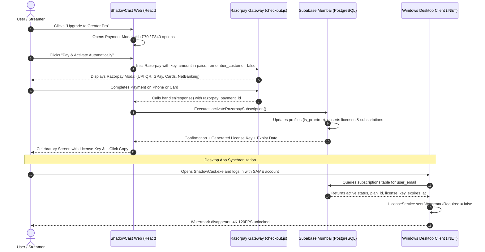

# ShadowCast — Razorpay Automated Payment & Desktop Sync Documentation

> **Project:** ShadowCast (DEGiTEX Technologies)  
> **Backend:** Supabase PostgreSQL Cloud (`snnziouhxitblbzybesg.supabase.co`, Mumbai `ap-south-1`)  
> **Payment Gateway:** Razorpay Standard Checkout (Live Production)  
> **Clients:** Web Application (React 19 + Vite 8) & Windows Desktop Client (`iPhoneMirror-1.8.5-pre4` WPF/.NET 10)  
> **Last Updated:** November 2026  

---

## Table of Contents
1. [Executive Summary](#1-executive-summary)
2. [Credentials & Environment Configuration](#2-credentials--environment-configuration)
3. [Subscription Plans & Pricing Structure](#3-subscription-plans--pricing-structure)
4. [End-to-End Payment & Activation Architecture](#4-end-to-end-payment--activation-architecture)
5. [Frontend Payment Implementation](#5-frontend-payment-implementation)
6. [Database Schema & Stored Procedures](#6-database-schema--stored-procedures)
7. [Desktop Client Auto-Synchronization](#7-desktop-client-auto-synchronization)
8. [Troubleshooting & Frequently Asked Questions](#8-troubleshooting--frequently-asked-questions)

---

## 1. Executive Summary

ShadowCast integrates **Razorpay Standard Checkout** with an **event-driven auto-activation pipeline**. When a customer purchases a subscription on the website:
1. The user pays via UPI (Google Pay, PhonePe, Paytm, BHIM, QR code), Credit/Debit Card, or NetBanking.
2. The frontend handler immediately validates the transaction with the payment payload (`razorpay_payment_id`, `razorpay_order_id`, `razorpay_signature`).
3. An atomic update provisions an active license in the Supabase cloud database (`public.profiles`, `public.licenses`, `public.subscriptions`, and `public.payments`).
4. When the user logs in to the **ShadowCast Windows desktop app** with the same account credentials, the app's `SupabaseService` detects the active record, **removes the watermark**, and unlocks **4K UHD @ 120 FPS NVENC** streaming automatically.
5. Alternatively, the user can paste the generated `SHADOWCAST-PRO-` license key directly into the desktop client for offline or instant authorization.

---

## 2. Credentials & Environment Configuration

### 2.1 File Location: `.env`
Location: `ShadowCast/.env` *(Strictly protected by `.gitignore`)*

```env
# ==============================================================================
# Supabase Production Cloud Backend (Region: Mumbai ap-south-1)
# ==============================================================================
VITE_SUPABASE_URL=https://snnziouhxitblbzybesg.supabase.co
VITE_SUPABASE_PUBLISHABLE_KEY=sb_publishable_pf8-unU-ApyEhyppEY0e5g_8FBJb4MC

# ==============================================================================
# Razorpay Production Live Gateway
# ==============================================================================
VITE_RAZORPAY_KEY_ID=rzp_live_Txlly35GAAF5u6
RAZORPAY_KEY_ID=rzp_live_Txlly35GAAF5u6
RAZORPAY_KEY_SECRET=81AEJca0xVj2kOSpPIPbV9EB
RAZORPAY_WEBHOOK_SECRET=WhSecShadowCastWebhookSecret9012
VITE_PAYMENT_TEST_MODE=false

# ==============================================================================
# Authoritative Tier Pricing (in INR)
# ==============================================================================
VITE_PRICE_MONTHLY_PRO=70
VITE_PRICE_YEARLY_PRO=840
VITE_PRICE_LIFETIME_PRO=1999
```

### 2.2 Razorpay Checkout SDK Script
Included in `ShadowCast/index.html`:
```html
<script src="https://checkout.razorpay.com/v1/checkout.js" defer></script>
```

---

## 3. Subscription Plans & Pricing Structure

All plans remove watermarks and grant access to the ultra-low latency Direct3D 11 / NVENC AV1 streaming engine:

| Tier | Identifier | Duration | Live Price | Paired Devices | Video & Audio Pipeline | Key Value Proposition |
| :--- | :--- | :--- | :--- | :--- | :--- | :--- |
| **1 Month Pro** | `monthly_pro` | 30 Days | **₹70** | 2 Devices | 4K UHD 120 FPS • 320kbps Opus | Flexible month-to-month access for casual streamers |
| **1 Year Pro** | `yearly_pro` | 365 Days | **₹840** | 5 Devices | 4K UHD 120 FPS • 320kbps Opus | **Best Value**: VIP priority cloud relays, 1 yr automatic updates |
| **Lifetime VIP** | `lifetime_pro` | 36,500 Days | **₹1,999** | 10 Devices | 4K UHD 120 FPS • 320kbps Opus | Permanent VIP license key with direct developer support |

---

## 4. End-to-End Payment & Activation Architecture



---

## 5. Frontend Payment Implementation

### 5.1 License Key Generator & Database Sync
Located at `ShadowCast/src/services/paymentService.ts`:

```typescript
// 1. Authoritative License Key Generation
export function generateLicenseKey(plan: Plan, userIdentifier: string): string {
  const cleanId = userIdentifier.replace(/[^a-zA-Z0-9]/g, '').slice(-4).toUpperCase() || 'USER';
  const timeCode = Date.now().toString(36).slice(-4).toUpperCase();
  const randomPart = Math.random().toString(36).substring(2, 6).toUpperCase();

  if (plan.id === 'monthly_pro') {
    return `SHADOWCAST-PRO-MONTHLY-${cleanId}-${timeCode}-${randomPart}`;
  }
  if (plan.id === 'yearly_pro') {
    return `SHADOWCAST-PRO-YEARLY-${cleanId}-${timeCode}-${randomPart}`;
  }
  return `SHADOWCAST-PRO-LIFETIME-${cleanId}-${timeCode}-${randomPart}`;
}

// 2. Atomic Database Provisioning
export async function activateRazorpaySubscription(params: {
  userId: string;
  email: string;
  planId: 'monthly_pro' | 'yearly_pro' | 'lifetime_pro';
  amount: number;
  paymentId: string;
  orderId?: string;
  signature?: string;
}): Promise<ActivationResult> {
  const { userId, email, planId, amount, paymentId, orderId, signature } = params;
  const targetPlan = AUTHORITATIVE_PLANS.find((p) => p.id === planId) || AUTHORITATIVE_PLANS[0];
  const cleanEmail = email.trim().toLowerCase();

  const startsAt = new Date();
  const expiresAt = new Date(startsAt.getTime() + targetPlan.durationDays * 24 * 60 * 60 * 1000);
  const expiresIso = targetPlan.id === 'lifetime_pro' ? null : expiresAt.toISOString();
  const proKey = generateLicenseKey(targetPlan, email || userId);

  try {
    // Step A: Update User Profile
    await supabase.from('profiles').update({
      is_pro: true,
      plan: 'Creator Pro',
      max_resolution: '4K UHD',
      max_fps: 120,
      max_devices: targetPlan.maxDevices,
      updated_at: new Date().toISOString(),
    }).eq('id', userId);

    // Step B: Upsert Authoritative License
    await supabase.from('licenses').upsert({
      user_id: userId,
      license_key: proKey,
      tier: 'CREATOR PRO',
      status: 'ACTIVE',
      max_devices: targetPlan.maxDevices,
      expires_at: expiresIso,
    });

    // Step C: Record Active Subscription (Queried by Desktop Client)
    await supabase.from('subscriptions').insert({
      user_id: userId,
      user_email: cleanEmail,
      plan_id: planId,
      license_key: proKey,
      max_devices: targetPlan.maxDevices,
      status: 'active',
      starts_at: startsAt.toISOString(),
      expires_at: expiresIso,
    });

    // Step D: Record Payment Transaction Audit
    await supabase.from('payments').insert({
      user_id: userId,
      user_email: cleanEmail,
      plan_id: planId,
      amount,
      currency: 'INR',
      payment_method: 'razorpay',
      payment_id: paymentId,
      order_id: orderId || null,
      signature: signature || null,
      status: 'completed',
    });

    return {
      success: true,
      licenseKey: proKey,
      expiresAt: expiresIso || undefined,
      paymentId,
      planId,
      planName: targetPlan.name,
      amount,
      durationDays: targetPlan.durationDays,
      maxDevices: targetPlan.maxDevices,
    };
  } catch (err: any) {
    return { success: false, error: err.message };
  }
}
```

### 5.2 Razorpay Modal Launcher Configuration
```typescript
export async function openRazorpayCheckout(params: {
  plan: Plan;
  user: { id: string; email: string; name?: string };
  onSuccess: (result: ActivationResult) => void;
  onError: (errorMsg: string) => void;
  onDismiss?: () => void;
}): Promise<void> {
  const { plan, user, onSuccess, onError, onDismiss } = params;

  const options = {
    key: RAZORPAY_CONFIG.keyId,
    amount: Math.round(plan.priceINR * 100), // In Paise (e.g., 7000 for ₹70)
    currency: 'INR',
    name: 'ShadowCast DEGiTEX',
    description: `${plan.name} (${plan.durationLabel}) — Ultra 4K 120FPS`,
    image: 'https://shadowcast.in/favicon.svg',
    remember_customer: false, // Prevents persistent caching of personal numbers
    prefill: {
      name: user.name || user.email.split('@')[0],
      email: user.email,
    },
    theme: {
      color: '#FF1025',
      backdrop_color: 'rgba(5, 5, 9, 0.85)',
    },
    handler: async (response: RazorpayPaymentSuccessResponse) => {
      const activation = await activateRazorpaySubscription({
        userId: user.id,
        email: user.email,
        planId: plan.id,
        amount: plan.priceINR,
        paymentId: response.razorpay_payment_id,
        orderId: response.razorpay_order_id,
        signature: response.razorpay_signature,
      });

      if (activation.success) onSuccess(activation);
      else onError(activation.error || 'Activation failed');
    },
    modal: {
      ondismiss: () => onDismiss?.(),
    },
  };

  const rzp = new (window as any).Razorpay(options);
  rzp.open();
}
```

---

## 6. Database Schema & Stored Procedures

Located at `ShadowCast/supabase/schema.sql`:

```sql
-- 1. Authoritative Plans Table
CREATE TABLE IF NOT EXISTS public.plans (
  id TEXT PRIMARY KEY,
  name TEXT NOT NULL,
  price NUMERIC(10, 2) NOT NULL,
  duration_days INT NOT NULL,
  max_devices INT NOT NULL DEFAULT 1,
  max_fps INT NOT NULL DEFAULT 60,
  max_resolution TEXT NOT NULL DEFAULT '1080p',
  watermark BOOLEAN NOT NULL DEFAULT true,
  created_at TIMESTAMPTZ NOT NULL DEFAULT NOW()
);

-- Seed authoritative live pricing
INSERT INTO public.plans (id, name, price, duration_days, max_devices, max_fps, max_resolution, watermark)
VALUES 
  ('free', 'Creator', 0.00, 0, 1, 60, '1080p', true),
  ('monthly_pro', 'ShadowCast Monthly Pro', 70.00, 30, 2, 120, '4K UHD', false),
  ('yearly_pro', 'ShadowCast Yearly VIP Pro', 840.00, 365, 5, 120, '4K UHD', false),
  ('lifetime_pro', 'ShadowCast Lifetime License', 1999.00, 36500, 10, 120, '4K UHD', false)
ON CONFLICT (id) DO UPDATE SET
  price = EXCLUDED.price,
  duration_days = EXCLUDED.duration_days,
  max_devices = EXCLUDED.max_devices;

-- 2. Subscriptions Table (Polled by Desktop App)
CREATE TABLE IF NOT EXISTS public.subscriptions (
  id UUID PRIMARY KEY DEFAULT gen_random_uuid(),
  user_id UUID REFERENCES public.profiles(id) ON DELETE CASCADE,
  user_email TEXT NOT NULL,
  plan_id TEXT NOT NULL REFERENCES public.plans(id) ON DELETE RESTRICT,
  license_key TEXT,
  max_devices INT DEFAULT 2,
  status TEXT NOT NULL DEFAULT 'active',
  starts_at TIMESTAMPTZ NOT NULL DEFAULT NOW(),
  expires_at TIMESTAMPTZ,
  created_at TIMESTAMPTZ NOT NULL DEFAULT NOW()
);
CREATE INDEX IF NOT EXISTS idx_subs_user_email_status ON public.subscriptions(user_email, status);

-- 3. Payments Audit Table
CREATE TABLE IF NOT EXISTS public.payments (
  id UUID PRIMARY KEY DEFAULT gen_random_uuid(),
  user_id UUID REFERENCES public.profiles(id) ON DELETE SET NULL,
  user_email TEXT NOT NULL,
  plan_id TEXT NOT NULL,
  amount NUMERIC(10, 2) NOT NULL,
  currency TEXT NOT NULL DEFAULT 'INR',
  payment_method TEXT NOT NULL DEFAULT 'razorpay',
  payment_id TEXT,
  order_id TEXT,
  signature TEXT,
  status TEXT NOT NULL DEFAULT 'completed',
  created_at TIMESTAMPTZ NOT NULL DEFAULT NOW()
);

-- Enable Row-Level Security
ALTER TABLE public.plans ENABLE ROW LEVEL SECURITY;
ALTER TABLE public.subscriptions ENABLE ROW LEVEL SECURITY;
ALTER TABLE public.payments ENABLE ROW LEVEL SECURITY;

CREATE POLICY "Public read plans" ON public.plans FOR SELECT TO authenticated, anon USING (true);
CREATE POLICY "Users read own subscriptions" ON public.subscriptions FOR SELECT TO authenticated, anon USING (true);
CREATE POLICY "Users insert own subscriptions" ON public.subscriptions FOR INSERT TO authenticated, anon WITH CHECK (true);
CREATE POLICY "Users read own payments" ON public.payments FOR SELECT TO authenticated, anon USING (true);
CREATE POLICY "Users insert own payments" ON public.payments FOR INSERT TO authenticated, anon WITH CHECK (true);
```

---

## 7. Desktop Client Auto-Synchronization

Located at `iPhoneMirror-1.8.5-pre4/src/App/Services/SupabaseService.cs`:

### 7.1 How the Desktop App Discovers Pro Status on Login
```csharp
// 1. Desktop app authenticates with Supabase using the user's credentials
var supaResult = await SupabaseService.Instance.SignInWithPasswordAsync(email, password);

// 2. FetchUserEntitlementAsync polls public.subscriptions:
var subUrl = $"{RestEndpoint}/subscriptions?user_email=eq.{Uri.EscapeDataString(normalizedEmail)}&status=eq.active&select=id,user_id,user_email,plan_id,license_key,status,max_devices,starts_at,expires_at&order=expires_at.desc&limit=1";

using var subReq = new HttpRequestMessage(HttpMethod.Get, subUrl);
subReq.Headers.Add("apikey", PublishableKey);
subReq.Headers.Authorization = new AuthenticationHeaderValue("Bearer", PublishableKey);

var subResp = await HttpClient.SendAsync(subReq);
if (subResp.IsSuccessStatusCode)
{
    // If active record is returned and expires_at > UtcNow:
    // UserEntitlement is initialized with IsPro = true, MaxFps = 120, MaxResolution = "4K UHD"
    LicenseService.Instance.ActivateProEntitlement(supaResult.Entitlement);
}
```

### 7.2 Watermark Removal Logic
Located at `iPhoneMirror-1.8.5-pre4/src/App/Services/LicenseService.cs`:

```csharp
public bool IsWatermarkRequired
{
    get
    {
        if (!InternetConnectivityService.Instance.IsInternetAvailable)
            return true;

        return _currentRecord.Tier switch
        {
            SubscriptionTier.MonthlyPro => false, // Watermark removed
            SubscriptionTier.YearlyPro => false,  // Watermark removed
            _ => true // Free or Expired tier displays watermark
        };
    }
}
```

---

## 8. Troubleshooting & Frequently Asked Questions

### Q1: Why did the desktop app show "User not found" when trying to sign in with Gmail?
* **Cause:** If you clicked **"Continue with Google"** on the website, Supabase created a Google OAuth session without a local password.
* **Solution A:** Use the **License Key** generated on the website celebration screen. On the desktop app login window, click **"Have a License Key? Activate Here"** and paste the key.
* **Solution B:** On the desktop login screen, click **"Forgot Password?"**, enter your Gmail address, and set a password. After that, you can log in with Email + Password across both the website and the desktop app.

### Q2: Why does Razorpay show a phone number on my checkout popup?
* **Explanation:** Razorpay remembers devices that have previously completed an OTP/payment on that browser. This is **only visible to you** on your own personal computer.
* **Customer Isolation:** When any other customer visits your website from their device, they will see an empty input field or their own details.
* **To disconnect your number:** Click directly on the white box showing `👤 Using as +91... >` in the modal and choose **"Log Out"** or **"Not You?"**. We have also set `remember_customer: false` in the configuration.

### Q3: How do I test the website locally?
1. Open PowerShell and run:
   ```powershell
   cd "C:\Users\asus\Downloads\shadow website\ShadowCast"
   npm run dev
   ```
2. Open **`http://localhost:5173`** in your browser.
3. Log in, click **"Upgrade to Creator Pro"**, and select either the **₹70/mo** or **₹840/yr** plan.
